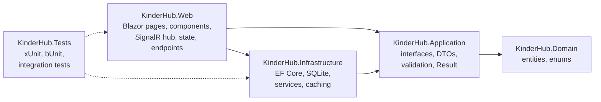

# KinderHub — Kindergarten Management System

KinderHub is a web application that connects **kindergarten administrators, teachers and parents**.
Teachers mark attendance and write daily reports, administrators manage groups and children,
and parents follow their child's day **live**: arrival, pick-up, meals, nap, mood and announcements.

Built with **C# / .NET 10 / Blazor Web App (Interactive Server)** as a final project.

---

## ✨ Features

| Area | What it does |
|---|---|
| 🔐 Roles & security | Login with ASP.NET Core Identity. Three roles: **Admin**, **Teacher**, **Parent**. Every page and endpoint is protected by role. |
| 👶 Children | Search (debounced), filter by group, paging, add / edit / delete with validation. |
| 🧩 Groups | Rooms, age ranges, capacity with occupancy bars. A full group refuses new children. |
| ✅ Attendance | One-click Present / Late / Absent / Sick, automatic check-in time, check-out, "mark all present". |
| 📝 Daily reports | Mood, meals, nap time, activities and a comment for parents. |
| 📢 Announcements | For everyone or for one group, "important" flag. |
| ⚡ Real-time | SignalR: parents see arrivals, pick-ups and new reports **instantly**; live "unread" counter. |
| 📊 Dashboard | Statistics, attendance chart (SVG, accessible, color-blind safe), group occupancy. |
| 📁 Export | Attendance history with virtual scrolling and CSV export (Excel). |
| 🌙 UI | Responsive design (phone / tablet / desktop), dark mode (remembered), accessible components. |
| 📱 PWA | Installable on phones and computers, friendly offline page. |
| 🩺 Monitoring | `/health` endpoint and an Admin **System status** page. |

## 🧱 Architecture (Clean Architecture)



* **Domain** — pure C# classes (Child, Group, AttendanceRecord, DailyReport, Announcement). No dependencies.
* **Application** — *what* the app can do: service interfaces, DTOs, validation rules, the `Result` pattern.
* **Infrastructure** — *how* it is done: Entity Framework Core + SQLite, service implementations, caching, retry strategy.
* **Web** — the user interface (Blazor), real-time hub, state container, HTTP endpoints.

Dependencies point **inwards** (Dependency Inversion): pages use `IChildService`, never the database directly.

## 🛠 Technology

.NET 10 · Blazor Web App (Interactive Server) · ASP.NET Core Identity · Entity Framework Core 10 · SQLite ·
SignalR · Bootstrap 5 + custom design system · xUnit · bUnit · WebApplicationFactory · coverlet

## 🚀 Installation

**Requirements:** [.NET 10 SDK](https://dotnet.microsoft.com/download) (Windows, macOS or Linux). Nothing else — the database (SQLite) is a file and is created automatically.

```bash
git clone <your-repository-url> KinderHub
cd KinderHub
dotnet build
dotnet run --project src/KinderHub.Web
```

Open the URL shown in the terminal (for example `http://localhost:5161`).
On first start the app creates both databases and fills them with demo data.

### Demo accounts

| Role | Email | Password |
|---|---|---|
| Admin | `admin@kinderhub.kz` | `Admin123!` |
| Teacher | `teacher@kinderhub.kz` | `Teacher123!` |
| Parent | `parent@kinderhub.kz` | `Parent123!` |

The demo parent has two children: Aruzhan (Sunflowers) and Alikhan (Little Stars).

### Reset the demo data

Stop the app and delete `src/KinderHub.Web/kinderhub.db` (and `src/KinderHub.Web/Data/app.db` for accounts). They are re-created on the next start.

## 🧪 Tests

```bash
dotnet test
```

78 automated tests: unit, service (real in-memory SQLite), component (bUnit) and HTTP integration tests.
See [tests/KinderHub.Tests/README-TESTS.md](tests/KinderHub.Tests/README-TESTS.md) for coverage reports.

## 📚 Documentation

| Document | For whom |
|---|---|
| [User Guide](docs/USER-GUIDE.md) | Admins, teachers and parents |
| [Developer Notes](docs/DEVELOPER-NOTES.md) | Developers: architecture, patterns, how to extend |
| [API Documentation](docs/API.md) | Integrators: HTTP endpoints, SignalR messages, OpenAPI |
| [QA Checklist & Bug Log](docs/QA-CHECKLIST.md) | Testers: manual test cases, browsers, devices |

## 📂 Project structure

```
KinderHub/
├─ src/
│  ├─ KinderHub.Domain/          Entities and enums
│  ├─ KinderHub.Application/     Interfaces, DTOs, validation, Result
│  ├─ KinderHub.Infrastructure/  EF Core, SQLite, services, caching
│  └─ KinderHub.Web/             Blazor UI, SignalR, state, endpoints
├─ tests/KinderHub.Tests/        Unit, service, bUnit, integration tests
└─ docs/                         User guide, developer notes, API, QA
```


| Name | Role in the project |
|---|---|
| Farzana Khashi | Full-stack development, testing, documentation |
| Ulsaya Tileuova | Attendance CSV export, testing |
| Zhanar Adilkhan | Project development and documentation |

